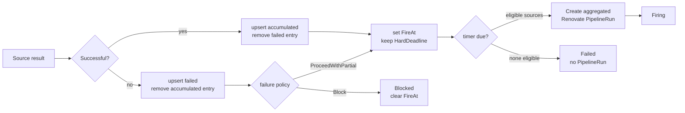

# NudgeConfig batch failure handling

This document describes how a batched nudge handles source-build failures. It
is intentionally self-contained so that maintainers do not need access to Jira
to understand the behavior.

## Data flow

For each batched target, a successful build or validated Snapshot is recorded
in `NudgeConfig.status.activeBatches[].accumulated`. A failed source result is
recorded in `failed`. The NudgeConfig controller wakes at the earlier of the
debounce time and hard deadline. When eligible contributors remain, it creates
one aggregated Renovate PipelineRun and records the batch as `Firing`.

## Invariants and policy

`failurePolicy` is resolved per target: `targetConfig[].batchPolicy` overrides
`batchDefaults`, which otherwise falls back to the API runtime default.

- `Block` changes a batch to `Blocked`, clears `fireAt`, and prevents timer
  delivery until a repair or a qualifying force-fire action.
- `ProceedWithPartial` keeps the batch `Accumulating`. A failed source is
  visible in `failed`, while successful sources can still be delivered.
- The latest result for a source is authoritative. A newer failure removes any
  older successful digest from `accumulated`; a later success removes the
  failure and restores that source as eligible. This avoids intentionally
  delivering a known-stale digest.
- Every observation in an accepting partial batch resets `fireAt` to
  `now + debounceTimeout`. `createdAt` and `hardDeadline` never move, so
  continuous activity cannot delay delivery forever.
- A partial batch with no eligible sources reaches its timer, becomes `Failed`,
  and never creates an empty Renovate PipelineRun.
- Once a batch is `Firing`, later source observations are collected by the
  next accepting batch. The selected firing payload is therefore stable across
  retries and controller restart recovery.

## Implementation boundaries

The state transitions and timer scheduling live in
`tekton/nudging/nudge_batch.go`. Aggregated Renovate configuration and
annotations are built by the existing batched PipelineRun path. Filtering
eligible sources immediately before payload construction ensures that both
`nudging-components` and `nudging-digests` represent only the delivered
sources, including when status contains legacy or overlapping entries.

## References

- ADR-0072, *Batched Nudging for Many-to-One Component Dependencies*.
- KFLUXSE-580, Phase 3 failure-handling Epic; KFLUXSE-485, KFLUXSE-487,
  KFLUXSE-593, and KFLUXSE-595 define the detailed lifecycle behavior.
- [#1766](https://github.com/konflux-ci/integration-service/pull/1766), hard
  deadline firing.
- [#1824](https://github.com/konflux-ci/integration-service/pull/1824),
  aggregated Renovate PipelineRun creation.
- [#1825](https://github.com/konflux-ci/integration-service/pull/1825),
  completion tracking; [#1815](https://github.com/konflux-ci/integration-service/pull/1815),
  cleanup; and [#1816](https://github.com/konflux-ci/integration-service/pull/1816),
  restart recovery.
