<h1>NudgeConfig Controller</h1>

The NudgeConfig controller reconciles the singleton `nudge-config` NudgeConfig CR in each namespace.
It processes two concerns on every reconcile: one-shot `spec.actions` (currently `forceFire`) and
scheduled batch lifecycle transitions. Batch state is persisted entirely in `status.activeBatches`
so it survives controller restarts.

**Governing ADRs:** ADR-0056 (one-shot actions pattern), ADR-0072 (batch aggregation semantics).

## Reconciliation Flow

```mermaid
%%{init: {'theme':'forest'}}%%
flowchart TD
  %% Defining the styles
    classDef Red fill:#FF9999;
    classDef Amber fill:#FFDEAD;
    classDef Green fill:#BDFFA4;

  predicate((PREDICATE: <br>NudgeConfig generation changed OR <br> annotation changed OR <br> status.activeBatches changed OR <br> spec.actions changed))

  %%%%%%%%%%%%%%%%%%%%%%% Drawing forceFire action path

  %% Node definitions
  has_force_fire{spec.actions.forceFire <br> is set?}
  clear_prior_conditions(Clear prior ForceFireRejected <br> and ForceFireIgnored conditions)
  process_force_fire(ProcessForceFireAction: <br> find target batch, validate, <br> call fireBatch)
  force_fire_result{forceFire result?}
  set_rejected_condition(Set ForceFireRejected <br> or ForceFireIgnored condition)
  clear_actions("ClearNudgeConfigActions: <br> set spec.actions = nil <br> (ALWAYS, regardless of outcome)")
  continue_to_batches(Continue to batch processing...)

  %% Node connections
  predicate                ---->      |"Reconcile()"|has_force_fire
  has_force_fire           --Yes-->   clear_prior_conditions
  has_force_fire           --No-->    continue_to_batches
  clear_prior_conditions   -->        process_force_fire
  process_force_fire       -->        force_fire_result
  force_fire_result        --Success--> clear_actions
  force_fire_result        --Error-->   set_rejected_condition
  set_rejected_condition   -->          clear_actions
  clear_actions            -->          continue_to_batches

  %%%%%%%%%%%%%%%%%%%%%%% Drawing ProcessDueNudgeBatches path

  %% Node definitions
  process_due(ProcessDueNudgeBatches: <br> iterate all activeBatches)
  batch_phase_check{Batch phase?}
  skip_non_accumulating(Skip batch)
  timer_expired{"batchTimerExpired? <br> (FireAt or HardDeadline <br> has passed)"}
  skip_not_due(Skip batch)
  has_accumulated{Has accumulated <br> entries?}
  mark_failed_empty(Mark batch Failed: <br> no successful builds)
  already_firing{"isBatchFiringForTarget? <br> (concurrency guard)"}
  skip_concurrent(Skip batch — <br> another batch for same <br> target is already firing)
  fire_batch("fireBatch: <br> build Renovate payload from <br> ALL accumulated entries, <br> create PipelineRun")
  fire_result{fireBatch result?}
  mark_firing(Set batch phase = Firing, <br> record NudgePipelineRun name)
  mark_failed_fire(Set batch phase = Failed, <br> record error message)
  patch_due_status(Patch status.activeBatches)

  %% Node connections
  continue_to_batches      ---->      |"ProcessDueNudgeBatches()"|process_due
  process_due              -->        batch_phase_check
  batch_phase_check        --Accumulating--> timer_expired
  batch_phase_check        --Other-->        skip_non_accumulating
  timer_expired            --Yes-->   has_accumulated
  timer_expired            --No-->    skip_not_due
  has_accumulated          --Yes-->   already_firing
  has_accumulated          --No-->    mark_failed_empty
  already_firing           --Yes-->   skip_concurrent
  already_firing           --No-->    fire_batch
  fire_batch               -->        fire_result
  fire_result              --Success--> mark_firing
  fire_result              --Error-->   mark_failed_fire
  mark_firing              -->        patch_due_status
  mark_failed_fire         -->        patch_due_status
  mark_failed_empty        -->        patch_due_status

  %%%%%%%%%%%%%%%%%%%%%%% Drawing ProcessFiringNudgeBatches path

  %% Node definitions
  process_firing(ProcessFiringNudgeBatches: <br> iterate all activeBatches)
  firing_check{Batch phase = Firing <br> and NudgePipelineRun set?}
  skip_non_firing(Skip batch)
  load_plr(Load nudge PipelineRun)
  plr_complete{PipelineRun <br> completed?}
  wait_plr(Skip — still running)
  plr_succeeded{PipelineRun <br> succeeded?}
  mark_completed(Set batch phase = Completed)
  retry_exhausted{RetryCount >= <br> maxBatchNudgePLRRetries?}
  mark_failed_retries(Set batch phase = Failed: <br> exhausted retries)
  increment_retry(Increment RetryCount, <br> create new PipelineRun)
  retry_result{Retry result?}
  mark_failed_retry_err(Set batch phase = Failed)
  patch_firing_status(Patch status.activeBatches)

  %% Node connections
  patch_due_status         ---->      |"ProcessFiringNudgeBatches()"|process_firing
  skip_non_accumulating    ---->      process_firing
  skip_not_due             ---->      process_firing
  skip_concurrent          ---->      process_firing
  process_firing           -->        firing_check
  firing_check             --Yes-->   load_plr
  firing_check             --No-->    skip_non_firing
  load_plr                 -->        plr_complete
  plr_complete             --Yes-->   plr_succeeded
  plr_complete             --No-->    wait_plr
  plr_succeeded            --Yes-->   mark_completed
  plr_succeeded            --No-->    retry_exhausted
  retry_exhausted          --Yes-->   mark_failed_retries
  retry_exhausted          --No-->    increment_retry
  increment_retry          -->        retry_result
  retry_result             --Success--> patch_firing_status
  retry_result             --Error-->   mark_failed_retry_err
  mark_completed           -->        patch_firing_status
  mark_failed_retries      -->        patch_firing_status
  mark_failed_retry_err    -->        patch_firing_status

  %%%%%%%%%%%%%%%%%%%%%%% Drawing requeue calculation

  %% Node definitions
  calc_requeue(NextBatchWakeDuration: <br> find earliest FireAt among <br> Accumulating batches)
  has_firing_batches{Any batch in <br> Firing phase?}
  requeue_fast(RequeueAfter = <br> min of 5s and next wake)
  has_wake{Next wake <br> duration > 0?}
  no_requeue(Return — no requeue)
  requeue_wake(RequeueAfter = <br> max of 5s and next wake)

  %% Node connections
  patch_firing_status      ---->      |"Calculate requeue"|calc_requeue
  skip_non_firing          ---->      calc_requeue
  wait_plr                 ---->      calc_requeue
  calc_requeue             -->        has_firing_batches
  has_firing_batches       --Yes-->   requeue_fast
  has_firing_batches       --No-->    has_wake
  has_wake                 --Yes-->   requeue_wake
  has_wake                 --No-->    no_requeue

  %% Assigning styles to nodes
  class predicate Amber;
  class mark_failed_empty,mark_failed_fire,mark_failed_retries,mark_failed_retry_err Red;
  class mark_completed Green;
```

## Batch Recording (External Callers)

The batch entries are recorded outside the NudgeConfig controller, by the build pipeline controller and snapshot controller:

- **`RecordBuildForBatchedNudge`** — called by the build pipeline controller when a source build succeeds and the target is configured for batching. Records the `(component, digest, buildPLR)` tuple into the active batch via `upsertAccumulatedEntry` (dedup by component identity). Resets the debounce timer via `scheduleBatchFire`.
- **`RecordFailedBuildForBatchedNudge`** — called when a source build fails. Records the failure in `batch.Failed[]` via `upsertFailedEntry`. If `FailurePolicy` is `Block`, transitions the batch to `Blocked` phase.
- **`RecordValidatedSnapshotForBatchedNudge`** — called by the snapshot controller for `validated`-mode nudges after integration tests pass. Same accumulation logic as build recording but uses Snapshot reference as `sourceRef`.
- **`RecordFailedValidatedSnapshotForBatchedNudge`** — called when integration tests fail for a validated-mode nudge.

## ForceFire Action Detail

The `spec.actions.forceFire` one-shot action (ADR-0056 pattern) allows a user to bypass the batch debounce timer:

1. `findForceFireBatch` locates the target batch — prefers `Accumulating`, falls back to `Blocked` (if `includePartial=true`) or `Failed`.
2. `isBatchFiringForTarget` checks the concurrency guard — rejects if another batch for the same target is already firing.
3. `validateForceFireBatch` enforces `includePartial` semantics — rejects if `includePartial=false` and failed components remain.
4. `fireBatch` creates the aggregated Renovate PipelineRun.
5. `ClearNudgeConfigActions` removes `spec.actions` unconditionally — even if step 4 failed — to prevent infinite reconciliation loops.

## Event Predicates

The controller watches NudgeConfig with a custom `nudgeBatchStatusChanged` predicate that triggers reconciliation when:
- The resource is created (always)
- `status.activeBatches` changes (batch state transitions)
- `spec.actions` changes (one-shot action added or cleared)
- Generation changes (spec edits)
- Annotations change
